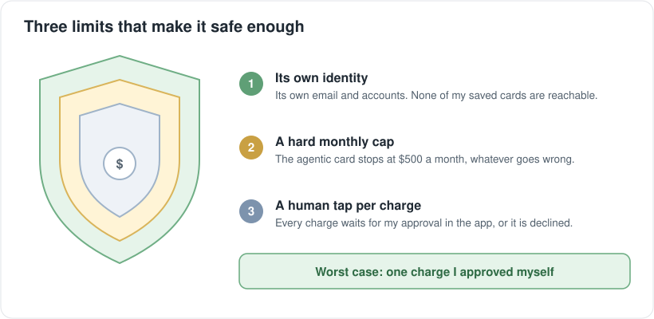

Most people picture an AI agent buying something by borrowing their identity: it logs into your account, in your browser, with your saved cards. That hands the agent everything you have.

I now think the better setup is the opposite. Give the agent its own machine and its own identity: its own email address, its own accounts. Then give it a card built for agents, with a hard monthly cap and a human tap on every charge. With those three limits, an agent can act in the real world, and the worst case is one charge you approved yourself.

A few weeks ago I wrote about how [my personal agent ordered my lunch](/agents/2026/10/26/my-personal-agent-ordered-my-lunch.html). Back then it borrowed my browser and my accounts. This time it had its own identity.

## When my identity wasn't available

I asked my personal AI assistant to order lunch. Normally it drives my own browser through an extension, where my food delivery account is signed in. That day the extension was closed, so my account was out of reach.

It tried two other ways and hit two walls. Logging into my Uber account from its own machine needed an email code and an SMS code, and that account holds all my other saved cards. I didn't want an agent in there. Creating its own Uber account needed a phone number, and virtual numbers don't receive Uber's login codes.

So it told me it couldn't order lunch. I pushed back: restaurants have their own websites.

_Three dead ends, then a guest checkout that worked on the second try._

## What worked: its own identity and its own card

The restaurant had its own ordering page with guest checkout. No account needed. Two things made that path work for an agent.

**Its own email.** My assistant has its own email account. It put that on the order, got the receipt, and read the confirmation itself. My inbox never came into it.

**Its own card.** I had set up an agentic card: a virtual Visa from my brokerage, made for AI agents. It is capped at $500 a month, and every charge waits for my tap in the app.

The first payment was declined. That was the card working as designed: the charge was waiting for me. I tapped approve, the assistant re-entered the card, and a $13 pickup lunch was ordered. It then wrote the lesson into its own playbook: if it can't use my browser, try the restaurant's site with guest checkout and its own card, never my accounts.

_Before: my accounts and every card in them. After: its own identity, one capped card, and my tap._

The same day I applied the idea to Amazon. My assistant had been shopping through my own signed-in session. I gave it its own Amazon account instead, added it to my Amazon Household so it shares Prime, made the agentic card its only payment method, and logged my session out. As I told it: "I want to give you full access, but this is safer."

## Three limits

Each limit covers a different failure.

1. **Its own identity.** Own email, own accounts. Nothing it signs into can reach my saved cards or my inbox.
2. **A hard cap.** $500 a month. A bug in a loop can't run up a big bill.
3. **A human tap per charge.** Nothing is charged until I approve it.

_Three limits, three different failures covered._

## What still hurts

- **Agents give up early.** Two blocked paths at one company became "I can't." A blocked path is not a blocked task.
- **A decline isn't always an error.** With a tap-per-charge card, a decline often just means "waiting for the human."
- **Phone numbers are the wall.** Email is easy to give an agent. A phone number is not, and many apps require one. That is why it has no Uber Eats account of its own yet.

## What this opens up

Once an agent has its own identity and a safe way to pay, a lot of chores stop needing my login: reordering household items, booking and paying small fees, renewing things, handling returns. It signs up as itself and keeps its own receipts. My accounts stay mine.

The setup is small: an email account, a few accounts in the agent's name, and an agentic card.

If you're thinking about trying this, or you think I've missed a failure mode, ask me. I'm happy to walk through how I set it up.
