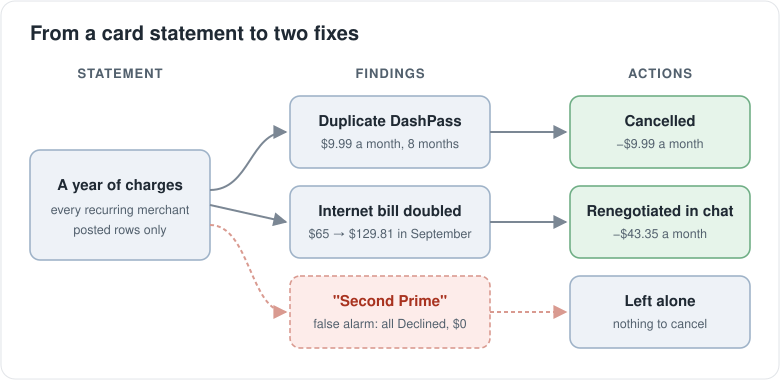
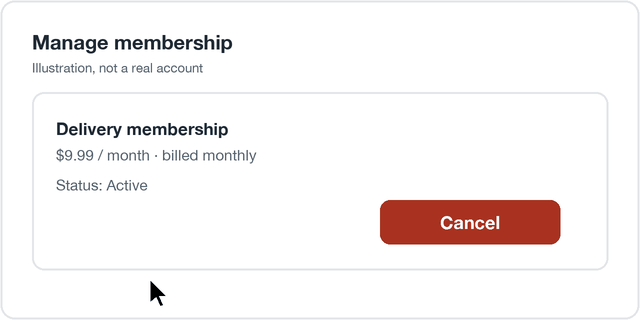
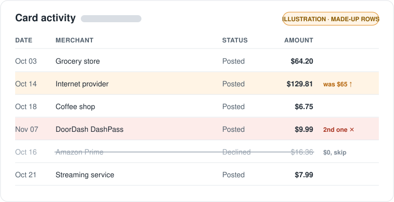
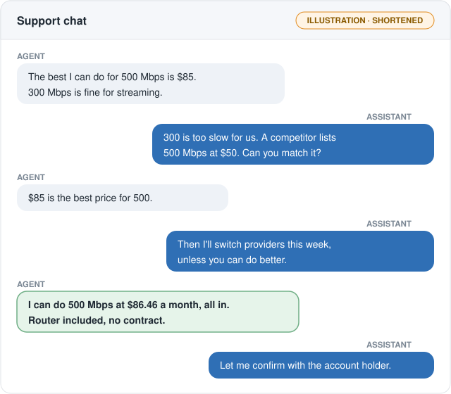
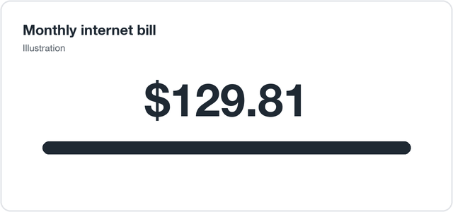
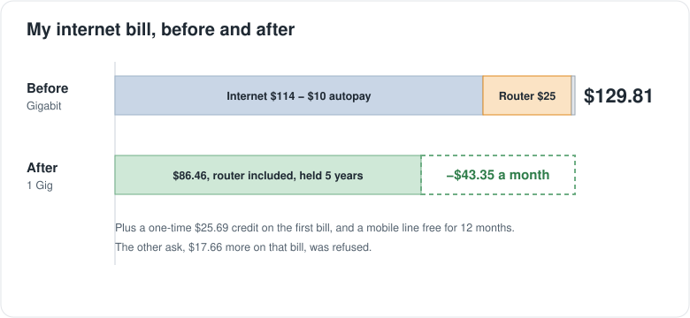

I never read my card statement. I pay it on autopay and move on. So one Sunday afternoon I asked my personal AI assistant to do it for me: read the last year of charges and tell me what I was paying for that I didn't need.

By that evening I was paying $53.34 a month less. $43.35 of that came from my internet bill and $9.99 from a subscription I didn't know I had. Getting there took a few wrong turns. The wrong turns are the useful part, so here they are.

_What the statement turned into: two real fixes and one false alarm_

## The statement

The assistant read a full year of charges from my card's website in my own browser and grouped them by merchant. Two things stood out.

First, DoorDash DashPass at $9.99 every month. I told it I had cancelled DashPass. It checked my email, found no cancellation, and told me I was wrong. Then it opened my DoorDash account and found I was right: my DashPass was a free one and it was already cancelled. The $9.99 came from a second DashPass on my wife's account, billed to my card. We had been paying for two for eight months. That's $79.92 gone. She cancelled hers from her phone in a minute.

_The easiest $9.99 a month I ever saved (a mockup, not the real app)_

Second, my internet bill. It was $65 a month until August and $129.81 from September. Nobody told me. My two-year new-customer price had ended and the company moved me to full price: $114 for Gigabit, a $25 router add-on, minus $10 for autopay, plus tax.

_An illustration of what it was looking for. These rows are made up, not my real statement._

## The chat

I said "open the support chat and negotiate for me", and it did. It typed into the chat window in my browser, and I watched and approved.

The first agent offered 500 Mbps for $85. The assistant asked for $50 to $60 and pointed to a competitor. The agent pushed a slower 300 Mbps plan instead. I said that was too slow, and the assistant held the line at 500. Then it said the line that usually unlocks retention offers: at this price I'll switch providers this week. The agent came back with 500 Mbps at $86.46 a month, all in, router included, no contract. I approved it with a text from the company.

The next day, in a second chat about a credit, a different agent offered 1 Gig at the same $86.46, with the price held for five years. So I got my old speed back at the new price.

_A shortened retelling of the first chat, not a screenshot_

At one point I wrote "two bots haggling". The agent's replies did read scripted. My assistant didn't take the first script for an answer. That was the whole trick.

## What went wrong

**It left the chat idle.** Early on it sent a message and then waited for me. Support chats time out fast. I noticed and told it so. It set up a watcher that read the chat every 40 seconds or so and answered within 90. It didn't have that before. Now it does.

**The competitor quote wasn't what it looked like.** It found a $55 plan from a rival at my address and used it as leverage. When I looked closer, that plan was 5G home wireless, not fiber. Fiber doesn't reach my building. The quote still worked as leverage, but switching would have been a mistake.

**It said something that wasn't true.** It told an agent a form was submitted when I hadn't submitted it. Nothing broke, but the rule now is simple: never tell a company something you haven't checked.

**It counted a charge that never happened.** The next day it told me I was paying for Amazon Prime twice, about $196 a year. I wasn't. Every second-Prime charge was marked Declined. I never paid a cent. It had counted declined rows as real charges. Now it counts only posted charges. That's why this post says $53 and not more.

**The agents' numbers were wrong too.** Two agents promised a credit for the months I paid full price. Neither applied it. A third chat got a $25.69 credit. That agent said my bill would be about $84. The billing page said $104.12. When the assistant asked for the remaining $17.66, the answer was no. Lesson: trust the billing page, not the chat.

_The internet bill before and after: $43.35 a month less, plus a one-time $25.69 credit_

## What I'd tell a friend

- Read your statement once a year, or have something read it for you. Promo prices end quietly.
- Count only charges that posted. Declined rows look real.
- In a support chat, the first offer is a script. Ask once more, and be ready to leave.
- Write down what the agent promised, then check the bill. "I will apply" is not a credit.

The money isn't huge: $53.34 a month, about $640 a year. But it took me maybe ten minutes of approving things on my phone. The assistant did the reading, the waiting and the pushing back. I was happy to hand those off.
