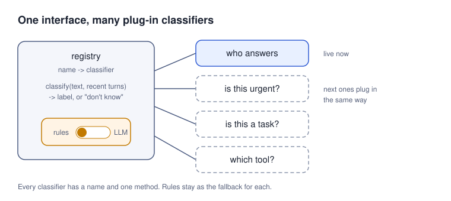

My personal AI assistant setup has two assistants in one chat. One is analytical and terse. The other is friendly and chatty. I like having both. But every message I send raises a small question first: who should answer? One of them, or both?

It needs an answer in milliseconds, on every message. This is how I moved that answer from rules to a small classifier.

## Rules first

I started with the obvious rules. An @-tag picks an assistant. A name at the start of the message picks that assistant. Otherwise, stick with whoever was picked last.

They broke on the most common message of all: a reply. "Sounds good." "Do that." "Wait, why?" None of these name anyone. They are answers to whoever spoke last, and the rules had no idea who that was. Topic hand-offs broke them too. I would be talking to the analytical one about a bug, then say "anyway, what should we do this weekend?", and the rules kept sending it to the bug fixer.

## What we tried

I hand-labelled 46 turns from my own real chats. Each one got a label: assistant A, assistant B, both, or undecided. The set stays private. Then I ran every option I could think of against it.

| Option | Accuracy | Latency | Runs |
|---|---|---|---|
| Keyword rules (name or @-tag, else default) | 37-44% | ~0 ms | local |
| Rules + "else last speaker" | 67% | ~0 ms | local |
| Gemma 3 4B, zero-shot, calibrated | 52% | fast | local |
| Arch-Router 1.5B (a topic router) | 33% | 66 ms median, 112 ms p90 | local |
| Gemma 4 26B MoE (few active params) | 83-85% | ~50-200 ms median, warm | local, free |
| Claude Haiku | 93.5% | 2-3 s per call | cloud, paid |
| Claude Sonnet (batched) | 93.5% | ~12 s per 46-turn batch | cloud, paid |

_Accuracy and latency for every option I tried_

A few things surprised me.

**One extra rule beat two models.** Adding "else, reply goes to whoever spoke last" took the rules from about 40% to 67%. That one line knew more about conversation than the small models did.

**Small zero-shot models are option-biased.** The 4B model loved one label. In one run it picked "both" on 41 of 46 turns. Calibrating it helped, but only to 52%.

**The topic router was the worst.** It is a fast 1.5B model trained to route requests. But it routes by topic and intent, and it answered its catch-all "other" on half the turns. "Sounds good" has no topic. It is a reply, and the router never learned who it replies to.

**The cloud models were the most accurate and too slow.** Two to three seconds is fine for a one-off job, not for every message.

**The local mixture-of-experts model was the sweet spot.** It has about 26B parameters in total but only a few are active per token, so it runs on my Mac mini. Given the last few turns, it got 83-85% right, at about 50 ms median once warm, for free.

The lesson: routing in a conversation is about turn-taking, not topic. A general model that can see the last few turns beats a specialist that only sees the message.

## Why a classifier, if an LLM gives one answer anyway?

Because a classifier gives you a probability for each label, not just one answer. With probabilities, I can set a confidence threshold. When the top label is not confident enough, the router says "undecided" and keeps the current pick instead of forcing a guess. And a classifier is cheap enough to run on every message, which a chatty model call is not.

_The path one message takes. The rules never go away; they catch every failure._

## Built to grow

I asked for the code to stay modular, because this won't be the only one. Every classifier is a named plug-in behind one interface: give it the text and the recent turns, get back a label or "don't know". A setting switches between rules and the model. @-tags skip the model entirely. If the model times out or returns garbage, the rules answer.

_One interface, many classifiers. The next ones plug in the same way._

The next ones are already obvious: is this urgent, is this a task, which tool should handle it.

## The bug a reviewer caught

While this was being merged, a reviewer found a good one. If I had explicitly picked an assistant, and the model then said "default", the model's default overrode my pick. Now an explicit pick wins, and the model only decides when nobody has.

## What's next

Few-shot prompting for the local model. Then the bigger idea: let the cloud models be the labellers. They are slow but accurate, which is exactly what you want from a teacher. Their labels can train a tiny model that is fast enough to run on every message and accurate enough that I stop noticing the router at all.
