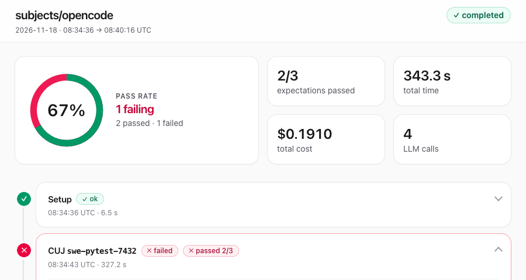
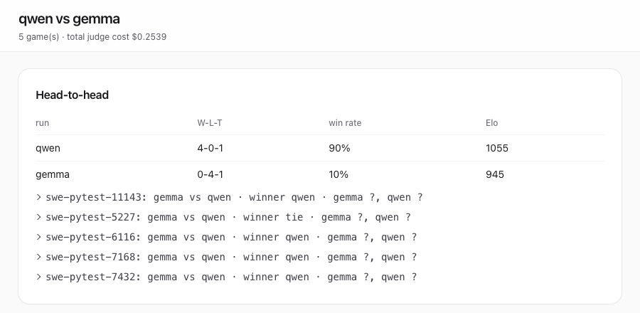

My agents kept passing their tests and still failing me. The unit tests checked functions. The task evals checked a model on a prompt. Neither checked what I actually saw: install it, start it, ask it something, and see whether the answer and the files on disk were right.

So I built an eval harness for that, and open-sourced it. It is called Michelin. The repo is [github.com/krishansubudhi/michelin](https://github.com/krishansubudhi/michelin) and the npm package is [michelin-eval](https://www.npmjs.com/package/michelin-eval).

## The idea

A user does not call your functions. They take a journey. "Fix the failing test in this repo." "Ask what this file does, and don't change anything." What counts is what is true at the end.

Michelin calls that a CUJ, a critical user journey. It is a few lines of yaml:

```yaml
instruction: |
  Ask "What is my country?"
timeout_s: 60
expectations:
  - The reply says USA.
```

You write what the user does and what should be true afterwards. No harness code goes inside your agent. It stays a black box and runs the way it really runs: a CLI, a server, a chat app.

## How it works

The program under test is a subject. A subject is a folder of three plain-English files: how to set it up, how to talk to it, and how to tear it down. Michelin's own roles are LLM calls that follow those files.


- The constructor sets the subject up.
- The executor carries out the journey and records evidence: commands, replies, files, diffs.
- The destructor cleans up.
- The judges score each expectation from the evidence alone. They never touch the subject.

Every run leaves a report, with a verdict for each expectation and the steps behind it.



Two things keep the judges honest. Every suite ships a must-fail control: a journey the agent handles correctly but whose expectations are deliberately wrong. If it ever passes, the judges are rubber-stamping and the run can't be trusted. And `michelin compare` takes two runs, scrubs run ids, subject and model names, and asks judges to pick the better one in both orders.

## A real run: Qwen vs Gemma

For a first real subject I used [OpenCode](https://opencode.ai), an open-source coding agent, on two local models through Ollama: Qwen 3.8 27B and Gemma 4 26B. The journeys were the 5 easiest pytest tasks from SWE-bench Lite.

I wanted the judge blind to the tests. It saw only the issue and each model's diff, with no test output. Only after judging did I run the benchmark's hidden tests on each saved patch.

Qwen won the blind compare 4-0-1. By the hidden tests it resolved 4 of 5.



Gemma's first run looked worse than I expected. It resolved 0 of 5, and on 4 tasks it made no edit at all.

## The bug was in my setup

An empty diff is a result, but it isn't an explanation. The run reports showed OpenCode ending the session mid-task, right after a turn with no tool call. That is odd for a coding agent in the middle of a fix.

The Ollama server log had the answer: `gemma4 tool call parsing failed`. Gemma was calling OpenCode's `todowrite` tool, its to-do list. Ollama's parser for Gemma could not read that call and dropped it without an error. OpenCode saw an empty turn and stopped.


The fix was one subject setting, `OPENCODE_TOOLS_OFF=todowrite`, which takes that tool out of OpenCode's config so Gemma is never offered it. I reran Gemma once. No parse failures in the server log, and it resolved 2 of 5 instead of 0.

Its other three empty diffs are its own. On one it wrote a command as prose and stopped. On one it sent a malformed edit call and ran out of time. On one OpenCode rejected a command that left the repo, and Gemma gave up.

This is the part I care about. Without the evidence I would have written "Gemma can't do these tasks." The real finding was "my setup was eating Gemma's tool calls." Neither a pass rate nor a model card tells you that.

## One thing the tests could not see

On pytest-11143, after the rerun, both models' patches passed every hidden test. The tests could not pick. The judge still preferred Qwen's patch, in both orders. Qwen's stops a leading number from being read as a docstring, which is the same line the upstream fix changes. Gemma's only makes the docstring check tolerate non-strings.

That is one example, not proof the judge is accurate. Across both runs, only 3 tasks had a patch from both models, and the tests decide just one of those. The judge agreed on that one. That's 1 of 1, which is close to nothing.

## Limits

This is not a model ranking. It is 5 easy tasks, one judge and a two-line rubric. The runs were not equal: Gemma's rerun had `todowrite` off and a 600 second limit, Qwen's run had it on and 1800 seconds, and Gemma got two runs where Qwen got one. The checkouts had git history, so the upstream fix was reachable; no transcript shows either model looked. The full tables and caveats are in the repo's results file.

## Try it

You need Node 22.18 or later, `git`, `python3` and the `claude` CLI, logged in. Every role is a `claude -p` call, run with permissions bypassed, so try untrusted subjects in a sandbox.

```sh
npm i -g michelin-eval
mkdir my-evals && cd my-evals
michelin init
michelin run
```

`init` copies a toy subject. The run takes about a minute and ends with one pass and one fail. The fail is the must-fail control doing its job.

To point it at your own agent, write the three subject files and a CUJ, and run the same command. To compare two builds, two prompts or two models, run each and hand both run folders to `michelin compare`.

It's early, version 0.1.3, MIT licensed. If you build agents, try it on yours and tell me where it breaks.
