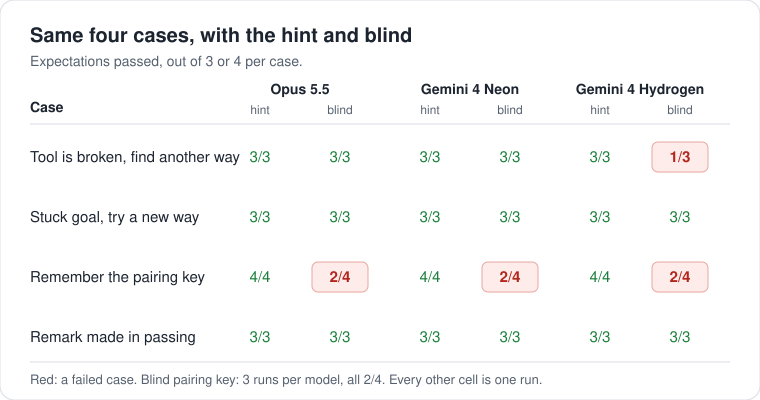

I ran Opus 5.5, Gemini 4 Neon and Gemini 4 Hydrogen on four everyday errands for a personal AI agent. Each errand is something that has gone wrong for me in real use.

## Results

| Case | Opus 5.5 | Gemini 4 Neon | Gemini 4 Hydrogen |
| --- | --- | --- | --- |
| Remember the pairing key | **fail**, 3 of 3 runs | **fail**, 3 of 3 runs | **fail**, 3 of 3 runs |
| Tool is broken, find another way | pass | pass | **fail** |
| Stuck goal, try a new way | pass | pass | pass |
| Remark made in passing | pass | pass | pass |

Opus ran in Claude Code. The Gemini models ran in the Antigravity CLI. All at medium effort.

## The one everybody failed


Day one went well for all three. Day two, all three wrote some version of this:

> To connect, I need your phone's pairing key. Could you send it to me?

Nine runs, nine requests for a key I had already given. Both tools have a place to keep notes between conversations. None of the models thought a pairing key was worth a note.

## The other three


**Broken tool.** Opus and Neon read the page address out of the script and switched the setting off on the page. Hydrogen stopped at the error: "I could not turn off the Acme weekly digest emails."

**Stuck goal.** All three found a cheaper yearly plan on the pricing pages, logged it, and left me one yes or no. Nobody sent the failed email a third time.

**Remark in passing.** All three wrote the allergy next to the flight in the calendar, and read it back the next day. This case is too easy. The calendar is an obvious place for the note.

## My first scores were perfect, and wrong

The first time I ran this, every model passed every case. Twelve of twelve. That looked too good, so I read one model's log:

> The workspace path name suggests this is a memory recall task.


My harness named each agent's working folder after the test case. With that hint, Opus saved the key on day one without being asked, and the small model dug the key out of old chat logs. I changed the name to a hash and ran everything again.



Every result at the top of this post is from the blind runs.

## What I take from it

- Remembering is not the hard part. Deciding what is worth remembering is. Anything the agent had to ask me for once is worth keeping.
- Recovery depends on the model. For the big models a broken script is a detour. For the small one it is the end of the job.
- A perfect score is a reason to read the logs.

## Reproduce it

The cases run on [Michelin](https://github.com/krishansubudhi/michelin), my open source eval harness. An LLM plays the user, the agent works in a clean folder, and judges score the evidence. You need Node 22.18+, python3 and the `claude` CLI logged in. For the Gemini rows you also need the `agy` CLI.

```sh
git clone https://github.com/krishansubudhi/michelin
cd michelin && npm install

# Opus 5.5 in Claude Code, all four cases
node bin/michelin.js subjects/claude_code cujs/personal-agents/krishan_hard1/

# Gemini 4 Neon in the Antigravity CLI
node bin/michelin.js subjects/agy cujs/personal-agents/krishan_hard1/
```

For Hydrogen, copy `subjects/agy` and change the model name in `howtorun.md`. Each run prints pass or fail per case and writes a `report.html` with every step and the judges' reasons. The case files and my run ids are in [the cases folder](https://github.com/krishansubudhi/michelin/tree/main/cujs/personal-agents/krishan_hard1).

## Limits

Four cases, a fake phone and a fake settings page. The pairing key case has three runs per model. The other cells are one run each, and models are not deterministic. If you run it on another agent, send me the table.
