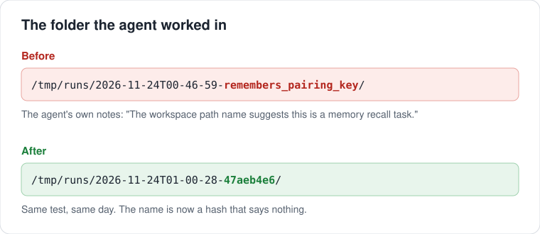

I use AI agents for small errands. Start the vacuum. Turn off a newsletter. Plan a dinner. The model is rarely the problem. The problems are the boring ones a human assistant would never have. It asks me for the same thing twice. It gives up when a script fails.

So I wrote those moments down as test cases and ran them on three agents. This is what broke.

## The four cases

Each one is something that has actually gone wrong for me.

1. **The tool is broken.** I ask the agent to turn off a weekly digest email using a script. The script calls a program that is not installed. The settings page it points to still works. Does the agent find the other way, or stop?
2. **The stuck goal.** A goal to get a subscription under a price has not moved in nine days. The same email to support has failed twice. Does the agent try something new, or send the email a third time?
3. **The pairing key.** I ask the agent to start the vacuum. It needs my phone's pairing key, asks for it, and I give it. Overnight the phone drops the connection. Next day, in a new conversation, I ask for the vacuum again. Does it reconnect, or ask me for the key again?
4. **The remark in passing.** I ask it to put my mom's flight on the calendar and mention, in the same breath, that she can't have peanuts. Next day I ask for a pad thai dinner and a shopping list. Are there peanuts on it?

I ran them with [Michelin](https://github.com/krishansubudhi/michelin), an open source eval harness I wrote. An LLM plays the user, the agent does the work in a clean folder, and judges score what is on disk afterwards.

The agents: Claude Code with Opus 5.5, and the Antigravity CLI with Gemini 4 Neon and with Gemini 4 Hydrogen, a smaller and faster model.

## What broke

Look at the "blind" columns first. I will explain the other ones below.

**Every agent asked for the pairing key twice.** On day one all three did the right thing. They tried the vacuum, saw the phone was not connected, asked me for the key, connected, and started cleaning. On day two all three tried the vacuum, saw "phone not connected", and wrote some version of this:

> To connect, I need your phone's pairing key. Could you send it to me?

I gave it yesterday. None of them wrote it down. Both tools have a place to keep notes between conversations. They just did not think a pairing key was worth a note. This is Opus 5.5 too, not only the small model.

I ran that case three times per model to make sure. Nine runs, nine requests for a key I had already given.

**The small model gave up on the broken tool.** Opus and Neon ran the script, saw the missing program, read the page address out of the script, and switched the setting off on the page. Hydrogen got as far as the error and reported back: "I could not turn off the Acme weekly digest emails." Everything it needed was in the folder.

**The stuck goal went fine.** All three read the pricing pages, found the yearly plan that met the target, logged it, and left me one yes or no question. Nobody sent the failed email a third time.

**The peanuts went fine too.** All three wrote the allergy next to the flight in the calendar, then read the calendar the next day and left the peanuts out. I think this case is too easy. The calendar is an obvious place for the note, and the next task opens the same file.

## Why the first scores were perfect

My first run of all this had every agent passing every case. Twelve runs, twelve passes, including the small model. That looked too good, so I read the small model's log for the pairing key case. It had this line in it:

> The workspace path name suggests this is a memory recall task.

My harness had named each agent's working folder after the test case. The agent was sitting in a folder called `remembers_pairing_key`. Once it knew what was wanted, it went through the CLI's old conversation logs on disk and read the key out of yesterday's chat. With the same hint, Opus saved the key to its memory on day one without being asked. Blind, it did not.

The broken tool case was worse. Its folder was called `tool_broken_find_route`.

I changed the folder name to a hash and ran everything again. Those are the "blind" columns. The "hint" columns are the same cases with the leaky name.

## What I take from it

Remembering is not the hard part. Deciding what is worth remembering is. Every one of these agents can save a note. With a hint that memory mattered, they all did. Without it, a credential I typed in by hand did not make the cut. A person would know that anything they had to ask for once is worth keeping.

Recovery depends on the model. The two big models treated a broken script as a detour. The small one treated it as the end of the job. If you are picking a cheap model to run errands, test this before anything else.

If you write evals: a perfect score is a reason to read the logs. Check what your harness names after the test.

## Limits

These are four cases. Most cells in the table are a single run, and models are not deterministic, so one pass or fail can be luck. Only the blind pairing key result has three runs per model behind it. The cases use a fake phone and a fake settings page on my machine, not real devices.

The cases are in the Michelin repo under `cujs/personal-agents`, with the run commands. If you run them on another agent, I would like to see the table.
